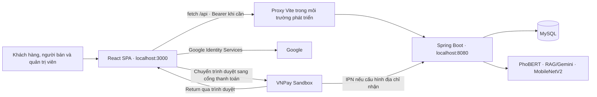

#  TeaSmart Frontend


TeaSmart là website thương mại điện tử chuyên về chè Thái Nguyên. Giao diện kết nối khách hàng, người bán và quản trị viên với danh mục sản phẩm, quy trình đặt hàng và các công cụ AI tư vấn, phân tích đánh giá và hỗ trợ nhận diện tình trạng lá chè.

**Đề tài tốt nghiệp** · Nghiên cứu và phát triển website bán chè Thái Nguyên “TeaSmart” tích hợp AI tư vấn và hỗ trợ phân loại tình trạng sâu bệnh dựa trên ảnh lá chè.

[Repository TeaSmart-Be](https://github.com/BigBoss1208/TeaSmart-Be)

## Mục lục

- [Giao diện TeaSmart](#giao-diện-teasmart)
- [Tính năng](#tính-năng)
- [Công nghệ và kiến trúc](#công-nghệ-và-kiến-trúc)
- [Cài đặt và cấu hình](#cài-đặt-và-cấu-hình)
- [Sử dụng website](#sử-dụng-website)
- [Cấu trúc thư mục](#cấu-trúc-thư-mục)
- [Build và kiểm thử](#build-và-kiểm-thử)
- [Xử lý lỗi](#xử-lý-lỗi)
- [Thông tin đồ án](#thông-tin-đồ-án)

## Giao diện TeaSmart


<details>
<summary>Khám phá chè · lọc danh mục và xem sản phẩm</summary>


</details>

## Tính năng

| Đối tượng | Chức năng |
| --- | --- |
| Khách truy cập | Xem trang chủ, câu chuyện TeaSmart, vùng chè, cửa hàng và hợp tác xã. Tìm kiếm, lọc danh mục và xem chi tiết sản phẩm. |
| Tài khoản | Đăng ký và đăng nhập bằng email hoặc Google khi đã cấu hình. Đặt lại mật khẩu qua OTP, quản lý hồ sơ, liên kết Google và quay lại trang hợp lệ sau đăng nhập. |
| Khách hàng | Yêu thích, thêm giỏ hàng, Mua ngay, quản lý địa chỉ, đặt hàng COD hoặc VNPay Sandbox, theo dõi và hủy đơn theo trạng thái, gửi đánh giá cho sản phẩm đủ điều kiện. |
| Người bán | Gửi hồ sơ đăng ký bán hàng, xem tổng quan, chỉnh hồ sơ gian hàng, đăng và quản lý sản phẩm, điều chỉnh tồn kho, xử lý đơn thuộc gian hàng, xem doanh thu và xuất báo cáo. Một số thao tác phụ thuộc cấu hình năng lực Seller trên Backend. |
| Quản trị viên | Quản lý danh mục, vùng chè, cửa hàng, sản phẩm, khách hàng, đơn hàng và đánh giá. Duyệt hồ sơ người bán, xem thống kê và phân tích cảm xúc đánh giá bằng PhoBERT. |

| Tính năng AI | Cách sử dụng |
| --- | --- |
| Chatbot A | Hỏi widget nổi về sản phẩm, giá, tồn kho, khẩu vị, ngân sách, quà tặng, bán chạy hoặc cách mua hàng. Nhánh này sử dụng quy tắc và dữ liệu từ Backend. |
| Chatbot B | Vẫn dùng widget đó để hỏi kiến thức chè. Backend tự chọn nhánh RAG/Gemini khi phù hợp, trả nguồn đã kiểm tra và thông báo khi dịch vụ hoặc bằng chứng chưa đủ. |
| Gợi ý sản phẩm | Xem gợi ý trên trang sản phẩm hoặc nhận tư vấn theo khẩu vị và nhu cầu. Backend xếp hạng theo thuộc tính catalog. |
| Phân loại lá chè | Mở `/leaf`, chọn ảnh hoặc video, đăng nhập để phân tích rồi xem nhóm tình trạng, điểm dự đoán và mức đồng thuận giữa các khung video. |

## Công nghệ và kiến trúc

| Thành phần | Phiên bản hoặc cách triển khai |
| --- | --- |
| Giao diện | React và React DOM 19.3.0, TypeScript 5.9.3 |
| CSS | Tailwind CSS 4.3.3, CSS theo trang và component |
| Build | Vite 8.3.3, `@vitejs/plugin-react` 6.1.2, `@tailwindcss/vite` 4.3.3 |
| Điều hướng, trạng thái và HTTP | History API của trình duyệt trong `src/App.tsx`, React hooks và `fetch` qua các API client trong `src/lib` |
| Bản đồ | Leaflet 1.9.4 và React Leaflet 5.0.0 |
| Báo cáo và biểu đồ | ExcelJS 4.4.0, pdfmake 0.3.13, biểu đồ SVG/CSS |
| Đăng nhập Google và biểu tượng | Google Identity Services qua SDK trình duyệt, biểu tượng SVG trong component |



## Cài đặt và cấu hình

Để demo phân loại ảnh/video, chạy Spring Boot và dịch vụ Leaf theo README Backend. Chuẩn bị bộ checkpoint bàn giao trước khi khởi động dịch vụ Leaf.

Cần Git, Node.js từ 22.12 trở lên và npm đi kèm. Môi trường đã kiểm tra phiên bản dùng Node.js 24.19.0 và npm 11.17.0. Chạy Backend cùng MySQL để dùng catalog và thương mại điện tử. Bật từng dịch vụ AI theo chức năng cần demo. [Repository Backend và hướng dẫn khởi động](https://github.com/BigBoss1208/TeaSmart-Be).

```powershell
git clone https://github.com/BigBoss1208/TeaSmart-FE.git
cd TeaSmart-FE
npm ci
```

| Cấu hình | Cách khai báo | Mặc định hoặc giá trị mẫu |
| --- | --- | --- |
| `TEASMART_BACKEND_URL` | Biến môi trường của Terminal chạy Vite. Chỉ đặt khi Backend dùng địa chỉ khác. | `http://127.0.0.1:8080` |
| `VITE_GOOGLE_CLIENT_ID` | `.env.local` ở thư mục Frontend. Chỉ cần cho Google Login. | Client ID công khai của OAuth Web Client, dạng `<client-id>.apps.googleusercontent.com` |

Dùng [.env.example](.env.example) làm mẫu cho Google Client ID. Google Login cần bật cấu hình tương ứng ở Backend. Dùng cùng Client ID ở hai phía và khai báo origin `http://localhost:3000` trong cấu hình Google. Google Client Secret, JWT secret, khóa VNPay và Gemini được cấu hình ở dịch vụ tương ứng.

Khởi động trong thư mục Frontend. Vite proxy mọi yêu cầu `/api` sang Spring Boot. Cổng 3000 dùng `strictPort`.

```powershell
# Chỉ cần nếu muốn đặt đích proxy một cách tường minh
$env:TEASMART_BACKEND_URL = "http://127.0.0.1:8080"
npm run dev
```

Mở [TeaSmart trên localhost:3000](http://localhost:3000). Với bản production, cấu hình máy chủ phục vụ `dist/`, chuyển `/api/*` tới Spring Boot và trả `index.html` cho route SPA như `/leaf` và `/payment/vnpay-return`.

## Sử dụng website

| Đường dẫn | Thao tác |
| --- | --- |
| `/`, `/explore`, `/tea-regions`, `/shops` | Khám phá vùng chè, cửa hàng, tìm và lọc sản phẩm. |
| `/products/<id>` | Xem sản phẩm, chọn số lượng, thêm giỏ hoặc bấm **Mua ngay**. Sau khi đăng nhập từ một thao tác được bảo vệ, trở lại trang để tự xác nhận bước tiếp theo. |
| `/dang-nhap`, `/dang-ky`, `/quen-mat-khau` | Đăng nhập, tạo tài khoản hoặc nhận hướng dẫn khôi phục mật khẩu khi tính năng được bật. |
| `/cart`, `/checkout` | Chọn sản phẩm và địa chỉ, kiểm tra tổng tiền, chọn COD hoặc VNPay Sandbox khi đã cấu hình. |
| `/account?tab=orders`, `/account/orders/<id>` | Xem lịch sử, trạng thái thanh toán, giao hàng và chi tiết đơn. |
| Widget trò chuyện | Hỏi sản phẩm hoặc kiến thức chè. Trên trang chi tiết, widget có thể gửi ID của sản phẩm đang xem. |
| `/leaf` | Tải JPEG/PNG tối đa 10 MiB hoặc MP4 tối đa 30.000.000 byte và 15 giây. Kết quả hỗ trợ quan sát ban đầu. Điểm dự đoán của tệp là xác suất mô hình, còn độ chính xác thực nghiệm được đo trên tập ảnh Test riêng. |
| `/seller`, `/admin` | Mở kênh người bán hoặc trang quản trị bằng tài khoản có quyền tương ứng. |

## Cấu trúc thư mục

```text
.
├── src/
│   ├── App.tsx        # Điều hướng, phiên người dùng và luồng chính
│   ├── components/   # Điều hướng, widget, gợi ý, đăng nhập Google
│   ├── pages/        # Sản phẩm, giỏ, Checkout, Leaf, Seller, Admin
│   ├── lib/          # HTTP, xác thực, thanh toán và hợp đồng API
│   ├── data/         # Nội dung và dữ liệu hỗ trợ hiển thị
│   ├── styles/       # Kiểu dáng dùng chung và theo chức năng
│   └── types/        # Khai báo TypeScript
├── public/           # Tài nguyên tĩnh, ảnh minh họa và video
├── tests/            # Hồi quy TypeScript và kịch bản trình duyệt
├── vite.config.ts     # Cổng phát triển và proxy API
└── package.json      # Dependencies và scripts
```

## Build và kiểm thử

Chạy từ thư mục Frontend. Dừng phiên dev của bạn trước khi dùng `preview` vì hai lệnh mặc định dùng chung cổng 3000. Kiểm tra API qua `dev` hoặc máy chủ đã cấu hình chuyển tiếp `/api`.

```powershell
npm run lint                 # Kiểm tra TypeScript với tsc --noEmit
npm run test:payment
npm run test:admin
npm run test:advisor
node --experimental-transform-types --test --test-concurrency=1 --test-timeout=25000 "tests/*.test.ts"
npm run build                # Kết quả trong dist/
npm run preview
```

Chạy bộ Node test tuần tự để tránh các worker Vite SSR dùng chung tài nguyên trên Windows. Các kịch bản trình duyệt trong `tests/` cần Chrome và Playwright. Có thể cung cấp đường dẫn module bằng biến `PLAYWRIGHT_MODULE`. Dùng môi trường kiểm thử cô lập cho đặt hàng, thanh toán và các thao tác ghi. Khi demo Leaf, dùng ảnh/video mẫu ngoài tập Test chính thức.

### Kết quả nghiệm thu ngày 26/11/2026

Bộ hồi quy frontend đạt **258/258 PASS**. Kiểm tra TypeScript và production build đều PASS. Phiên nghiệm thu chưa kiểm thử trực tuyến Gemini, Google OAuth, SMTP hoặc VNPay.

## Xử lý lỗi

| Triệu chứng | Kiểm tra |
| --- | --- |
| `/api` lỗi hoặc không có sản phẩm | Thử `GET http://localhost:8080/api/products?size=1`, kiểm tra Spring Boot và kết nối MySQL. Nếu đổi `TEASMART_BACKEND_URL`, khởi động lại Vite trong đúng Terminal. |
| Cổng 3000 đang dùng | Kiểm tra tiến trình đang giữ cổng, dùng phiên TeaSmart đang hoạt động hoặc tự giải phóng cổng rồi chạy lại. |
| HTTP 401 hoặc 403 | Đăng nhập lại nếu phiên hết hạn. Kiểm tra quyền khách hàng, người bán hoặc quản trị viên trên Backend. |
| Google Login không hiện hoặc báo sai origin | Kiểm tra `VITE_GOOGLE_CLIENT_ID`, origin OAuth và trạng thái bật Google trong Backend. |
| VNPay không mở hoặc quay về sai trang | Kiểm tra bật Sandbox, cấu hình merchant và Return URL `http://localhost:3000/payment/vnpay-return`. Với giao dịch chưa xác minh, dùng kiểm tra trạng thái trước khi thử lại. |
| Chatbot báo kiến thức chưa sẵn sàng | Kiểm tra cấu hình bật RAG ở Spring Boot và `GET /health` của Python. Tư vấn catalog theo quy tắc vẫn dùng dữ liệu Spring Boot. |
| Leaf báo bận, không sẵn sàng hoặc tệp không hợp lệ | Kiểm tra FastAPI cổng 8003, checkpoint, định dạng/tệp và giới hạn tải lên. |

## Thông tin đồ án

- **Sinh viên thực hiện** · Ngô Quang Mạnh · DTC235200495 · CNCNTTK22A.
- **Đơn vị** · Trường Đại học Công nghệ Thông tin và Truyền thông – Đại học Thái Nguyên.
- **Thời gian thực hiện** · 28/09/2026 – 07/12/2026.
- **Bản thảo nghiên cứu** · “Phân loại bảy nhóm tình trạng lá chè bằng học chuyển giao với mạng MobileNetV2”.
